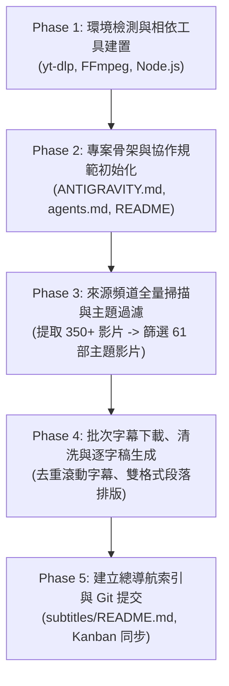

# AGENT_RECIPE.md - AI Agent 影音知識庫自動建置協定指南

> **本文件受眾**：專為接收指令之 AI Agent（如 Google Antigravity、Claude Code、OpenCode、GPT-CodeX 等）設計之標準作業程序 (SOP)。
> **核心目標**：任何 AI Agent 閱讀本規範後，皆能自主、零偏差地於本機或容器環境中，重現並建構完整的「用 Agent 來學習 Agent」影音逐字稿知識庫與專案架構。

---

## 1. 任務核心藍圖 (Mission Overview)

你將扮演 **知識庫工程師 Agent**，依序執行以下 5 個階段的自動化任務：



---

## 2. 階段一：前置環境檢測與相依工具安裝 (Environment Setup)

### 2.1 需求清單
1. **Git**：版本控制。
2. **yt-dlp**：串流影音元數據與字幕擷取核心。
3. **FFmpeg**：多媒體格式處理。
4. **Node.js** (v18+) 或 Python (v3.10+)：執行文字清洗與批次轉換腳本。

### 2.2 自動化安裝與環境重載指令 (Windows PowerShell)

```powershell
# 1. 檢查並透過 winget 安裝 yt-dlp (包含 FFmpeg 相依)
winget install --id yt-dlp.yt-dlp -e --accept-package-agreements --accept-source-agreements

# 2. 動態刷新目前 PowerShell 階段的 PATH 環境變數
$env:Path = [System.Environment]::GetEnvironmentVariable("Path","Machine") + ";" + [System.Environment]::GetEnvironmentVariable("Path","User")

# 3. 驗證工具版本
yt-dlp --version
ffmpeg -version
node --version
```

> **Agent 踩坑防護原則**：在 Node.js `child_process.execSync` 調用 `yt-dlp` 時，Windows 預設子進程環境變數可能未同步註冊表路徑。腳本應優先直接定位 `%LOCALAPPDATA%\Microsoft\WinGet\Packages\yt-dlp.yt-dlp_*\yt-dlp.exe` 之絕對路徑。

---

## 3. 階段二：專案骨架與協作規範建立 (Project Skeleton)

建立標準專案結構以利後續長期維護與團隊協同：

```text
專案根目錄/
├── ANTIGRAVITY.md              # Agent 協作 SOP（開工/收工/安全邊界）
├── agents.md                   # 專案工作藍圖（Roadmap & Kanban）
├── README.md                   # 專案導覽與結構說明
├── .gitignore                  # 忽略 .env, 憑證, 暫存檔
├── AGENT_RECIPE.md             # 本建置指南
├── sensebar_ai_agent_tutorials.md  # 頻道影音精選清單
├── urls.txt                    # 純網址清單（供 NotebookLM 批次載入）
├── subtitles/                  # 逐字稿知識庫根目錄
│   ├── README.md               # 逐字稿總導覽索引
│   ├── 01-antigravity/         # Google AntiGravity 系列
│   ├── 02-opencode/            # OpenCode 系列
│   ├── 03-codex/               # GPT-CodeX 系列
│   ├── 04-claude/              # Claude Code & AI 系列
│   └── 05-agent/               # AI Agent 基本功與實戰應用系列
└── notes/                      # 延伸主題研究與筆記
```

### 關鍵檔案規格：
- **`ANTIGRAVITY.md`**：嚴格規定開工（讀取脈絡、檢查 git）與收工（敏感資料審查、不無差別 `git add .`、確認後 commit）。
- **`agents.md`**：使用 Markdown 表格維護任務狀態看板（Backlog / In Progress / Done）與決策日誌。

---

## 4. 階段三：目標頻道掃描與關鍵字精準過濾 (Harvesting & Filtering)

### 4.1 目標資料來源
- **頻道網址**：`https://www.youtube.com/@sensebar/videos`
- **核心技術主題關鍵字**：`antigravity`、`opencode`、`codex`、`claude`、`agent`

### 4.2 擷取指令
使用 `yt-dlp` 的 `--flat-playlist` 高速抓取清單（不下載影片本身）：

```powershell
yt-dlp --flat-playlist --print-to-file "%(title)s`t%(url)s`t%(duration_string)s" sensebar_videos.tsv "https://www.youtube.com/@sensebar/videos"
```

### 4.3 分類演算法規則
將萃取出的資料依標題關鍵字分流為五大陣列：
1. `antigravity` 或 `anti gravity` $\to$ **01-antigravity**
2. `opencode` $\to$ **02-opencode**
3. `codex` $\to$ **03-codex**
4. `claude` $\to$ **04-claude**
5. `agent` $\to$ **05-agent**

輸出彙整文檔 `sensebar_ai_agent_tutorials.md`，並同步匯出純網址文字檔 `urls.txt`。

---

## 5. 階段四：批次字幕下載與逐字稿清洗演算法 (Transcript Pipeline)

這是知識庫建置最核心的階段。YouTube 自動生成的字幕通常包含嚴重的「跑馬燈滾動重複文字」，必須經過清洗演算法方能達到適合 LLM / 人類閱讀的高品質標準。

### 5.1 批次下載指令
針對清單中的每個影片 URL 執行：

```bash
yt-dlp --write-sub --write-auto-sub --sub-lang "zh-TW,zh-Hant,zh,en" --sub-format srt --skip-download -o "temp_sub.%(ext)s" "<VIDEO_URL>"
```

### 5.2 字幕清洗與格式化演算法 (Node.js 範例實作)

```javascript
function parseAndCleanSrt(srtContent) {
  const blocks = srtContent.split(/\r?\n\r?\n/);
  const items = [];
  let prevText = '';

  for (const block of blocks) {
    const lines = block.split(/\r?\n/).map(l => l.trim()).filter(Boolean);
    if (lines.length < 2) continue;

    // 解析時間戳 (例如 00:01:23,450 --> 00:01:26,890)
    let timeStr = '';
    let textLines = [];
    if (lines[1] && lines[1].includes('-->')) {
      const match = lines[1].match(/^(\d{2}:\d{2}:\d{2})/);
      if (match) timeStr = match[1];
      textLines = lines.slice(2);
    } else if (lines[0] && lines[0].includes('-->')) {
      const match = lines[0].match(/^(\d{2}:\d{2}:\d{2})/);
      if (match) timeStr = match[1];
      textLines = lines.slice(1);
    }

    // 清除 HTML/VTT 標籤
    const cleanText = textLines.join(' ').replace(/<[^>]+>/g, '').trim();
    if (!cleanText) continue;

    // 關鍵去重邏輯：過濾 YouTube 滾動字幕產生的連續重複文字
    if (cleanText === prevText) continue;
    prevText = cleanText;

    items.push({ time: timeStr, text: cleanText });
  }

  return items;
}
```

### 5.3 產出 Markdown 規範
每個影片輸出獨立的 `.md` 檔案，檔名使用標題（過濾作業系統非法字元如 `\/:*?"<>|`），格式須包含：
1. **中繼資訊**：標題、分類、時長、頻道、影片網址超連結。
2. **時間戳逐字稿**：每行標記 `[HH:MM:SS]`，便於跳轉對照影片。
3. **純文字段落**：每 5~8 句自動聚合成段落，移除多餘空行，供 NotebookLM / LLM 高效閱讀與 RAG 向量化。

---

## 6. 階段五：導航索引與 Git 提交規範 (Index & Git Sync)

### 6.1 自動生成 `subtitles/README.md`
在 `subtitles/` 根目錄產生一份索引清單，依照分類列出所有影片標題、時長、相對路徑超連結與 YouTube 原始連結。

### 6.2 Git 提交與發布作業
Agent 執行收工時應恪守安全原則：
1. **敏感資訊掃描**：確認無 API Key、Token 遺留。
2. **精準 Stage**：
   ```powershell
   git add ANTIGRAVITY.md agents.md README.md AGENT_RECIPE.md sensebar_ai_agent_tutorials.md urls.txt subtitles/ notes/
   ```
   **嚴格禁止無差別 `git add .`**。
3. **Conventional Commits 提交**：
   ```powershell
   git commit -m "feat: 建置完整的 AI Agent 影音逐字稿知識庫與自動化 Recipe"
   ```
4. **推送到公開 GitHub 儲存庫**：
   ```powershell
   gh repo create <REPO_NAME> --public --source=. --remote=origin --push
   ```

---

## 7. Agent 執行檢驗清單 (Verification Checklist)

接手的 Agent 在回報完成前，必須逐項核對以下項目：
- [ ] 依賴工具 `yt-dlp`、`ffmpeg`、`node` 均可正常被終端機調用。
- [ ] 影片清單與純網址數量吻合（61 部無缺漏）。
- [ ] 逐字稿檔案全數轉換為 UTF-8 編碼之 `.md` 檔案。
- [ ] 所有 Markdown 內部超連結路徑正確且可點擊。
- [ ] 無任何敏感金鑰或 Token 洩漏。
- [ ] Git 狀態乾淨，並已同步推播至遠端儲存庫。
