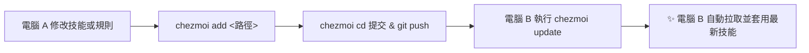

# 使用 chezmoi 同步 Agent 技能與全域設定實戰手冊 (Multi-Machine Sync Guide)

> **「一次 chezmoi add 存起來，另一台 chezmoi update 輕鬆跟上。」**  
> 本手冊指導如何使用現代 Dotfiles 管理神器 **chezmoi**，安全、乾淨且自動化地在多台電腦（Windows、macOS、Linux）之間同步 AntiGravity、Codex 等 AI Agent 的自定義技能與全域設定。

---

## 為什麼選擇 chezmoi 而非直接 git？

AI Agent（如 AntiGravity、Codex）的本機目錄結構通常非常龐大且複雜：

| 比較項目 | 傳統方式 (`git init ~`) | 現代做法 (`chezmoi`) |
| :--- | :--- | :--- |
| **污染度** | 家目錄被大量暫存、快取、通話記錄污染 | **精準納入 (Opt-in)**，只追蹤你指定的技能與設定檔 |
| **敏感資料安全** | 容易意外把 API Key、SQLite、Token 推上 GitHub | 預設乾淨隔離，支援 `.chezmoiignore` 與密鑰管理 |
| **跨系統相容** | Windows 路徑與 Unix 符號連結容易衝突 | 內建路徑轉譯與範本引擎 (Go template) |
| **同步效率** | 需手動處理 merge conflict 與檔案覆蓋 | **`chezmoi update` 一鍵拉取並自動套用** |

---

## 一、安裝 chezmoi

### 1. Windows (建議使用 winget)
開啟 PowerShell 執行：
```powershell
winget install twpayne.chezmoi
```
> 安裝完成後，請重新開啟終端機（PowerShell），確認版本：
> ```powershell
> chezmoi --version
> ```

### 2. macOS / Linux
```bash
# macOS (Homebrew)
brew install chezmoi

# Linux (一鍵腳本)
sh -c "$(curl -fsLS get.chezmoi.io)"
```

---

## 二、首次建立遠端儲存庫與初始化（電腦 A）

### Step 1. 在 GitHub 建立私有倉庫
1. 前往 GitHub 建立新的 Repository，名稱建議設為 `dotfiles` 或 `dotfiles-agents`。
2. **務必勾選 Private（私有儲存庫）**，確保個人設定與習慣不公開外洩。

### Step 2. 在電腦 A 初始化 chezmoi
```powershell
# 使用 SSH 協定初始化（請替換為你的 GitHub 使用者名稱與 Repo 名稱）
chezmoi init git@github.com:<你的GitHub帳號>/dotfiles.git

# 或者使用 HTTPS（需登入 GitHub 憑證）：
# chezmoi init https://github.com/<你的GitHub帳號>/dotfiles.git
```
此時 chezmoi 會在本地建立受控目錄：
- Windows: `~\.local\share\chezmoi`

---

## 三、精準納入 Agent 技能與全域設定 (chezmoi add)

根據本機實際路徑，執行以下指令將技能與設定納入 chezmoi 管理：

### 1. AntiGravity 專屬技能與設定
```powershell
# 1.1 納入所有自定義技能庫 (00-07 等技能)
chezmoi add ~\.gemini\config\skills

# 1.2 納入全域協作規範與開工收工流程
chezmoi add ~\.gemini\config\AGENTS.md

# 1.3 納入全域 MCP 擴展設定 (視需要)
chezmoi add ~\.gemini\config\mcp_config.json
```

### 2. Codex / 其他 Agent 設定 (若有使用)
```powershell
# 2.1 納入 Codex 技能庫
chezmoi add ~\.codex\skills

# 2.2 納入 Codex 全域規範
chezmoi add ~\.codex\AGENTS.md

# 2.3 納入 Codex 核心配置
chezmoi add ~\.codex\config.toml
```

> [!NOTE]
> `chezmoi add` 執行後，它會將檔案複製並改名存放至 `~\.local\share\chezmoi`（例如 `~/.gemini` 會對應為 `dot_gemini`）。

---

## 四、安全防護：配置 .chezmoiignore

為了嚴格防止動態暫存、通話歷史與敏感 Token 被加入 Git，我們進入 chezmoi 倉庫設定過濾規則：

```powershell
# 進入 chezmoi 本機儲存庫目錄
chezmoi cd
```

在該目錄建立或編輯 `.chezmoiignore`：
```gitignore
# 排除所有暫存與備份檔
**/*.bak*
**/*.tmp
**/*.log

# 排除資料庫與快取
**/*.sqlite*
**/*.db
**/cache/**
**/__pycache__/**

# 排除敏感身分驗證與 Token（嚴格禁止上傳）
dot_codex/auth.json
dot_codex/.sandbox-secrets
dot_gemini/antigravity/conversations/**
dot_gemini/antigravity/brain/**
```

---

## 五、提交並推送到 GitHub（電腦 A）

在 `chezmoi cd` 進入的目錄中，直接使用標準 Git 操作提交並推送：

```powershell
# 檢視當前已納入管理的檔案
git status

# 提交並推送
git add .
git commit -m "feat: sync antigravity skills, global rules and agent configs"
git push -u origin main

# 離開 chezmoi 目錄，回到原本的工作路徑
exit
```

---

## 六、另一台電腦快速跟上（電腦 B）

當你在新筆電、公司電腦或副機時，只需兩步：

### Step 1. 安裝 chezmoi
```powershell
winget install twpayne.chezmoi
```

### Step 2. 首次初始化並一鍵套用
```powershell
# 初始化並直接 apply 到目標系統
chezmoi init --apply git@github.com:<你的GitHub帳號>/dotfiles.git
```
🎉 **完成！** 此時電腦 B 的 `~/.gemini/config/skills`、`AGENTS.md` 已經完全同步且立即可用！

---

## 七、日常極簡維護工作流

日後當你有任何微調或擴充，遵循以下極簡循環：



### 1. 當你在電腦 A「新增或修改技能」時：
```powershell
# 將修改內容同步進 chezmoi
chezmoi add ~\.gemini\config\skills

# 提交並推送
chezmoi git -- commit -am "update: add new edge-tts voice skill"
chezmoi git -- push
```
*(你也可以用 `chezmoi cd` 手動進去推)*

### 2. 當你在電腦 B「想跟上最新狀態」時：
```powershell
# 一行搞定：自動 git pull 遠端最新變更，並套用到本機！
chezmoi update
```

### 3. 想在套用前先預覽差異 (Diff)：
```powershell
# 查看遠端或 chezmoi 與本機真實檔案的差異
chezmoi diff
```

---

## 八、進階技巧：多環境範本化 (Templates)

如果兩台電腦的作業系統不同（如一台 Windows、一台 macOS），或路徑稍有差異，可以將檔案轉為範本：

```powershell
# 將檔案轉為範本 (例如 config.toml.tmpl)
chezmoi add --template ~\.codex\config.toml
```
在範本中可以使用條件判斷：
```toml
{{- if eq .chezmoi.os "windows" }}
python_path = "C:/Python312/python.exe"
{{- else }}
python_path = "/usr/local/bin/python3"
{{- end }}
```

---

## 結語

透過 `chezmoi`，你再也不需要手動隨身碟複製、手動比對技能資料夾，或者擔心漏掉某個全域規範。打造個人的 **「AI Agent 隨身錦囊」**，在任何新環境下只需一條 `chezmoi init --apply`，頂級數位分身瞬間就位！
