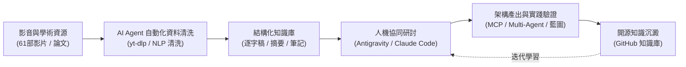

# 用Agent來學習Agent (Learning Agents with Agents)

<p align="center">
  <strong>以 AI Agent 作為學習夥伴與研究工具，系統化解構與構建現代 AI Agent 核心知識體系</strong>
</p>

<p align="center">
  <a href="https://github.com/williewu2008/learn-agent-with-agent/blob/main/LICENSE"></a>
  <a href="https://github.com/williewu2008/learn-agent-with-agent/stargazers"></a>
  <a href="https://github.com/williewu2008/learn-agent-with-agent/network/members"></a>
  <a href="https://github.com/williewu2008/learn-agent-with-agent/pulls"></a>
  
  
</p>

---

## 📖 目錄 (Table of Contents)

- [🎯 專案核心理念](#-專案核心理念)
- [✨ 核心亮點與成果](#-核心亮點與成果)
- [📺 61 部 AI Agent 系列影音逐字稿知識庫](#-61-部-ai-agent-系列影音逐字稿知識庫)
- [🎙️ NotebookLM 語音播客與知識庫研讀指南](#️-notebooklm-語音播客與知識庫研讀指南)
- [📂 專案目錄結構](#-專案目錄結構)
- [🤖 給其他 AI Agent 的自動建置協定 (AGENT_RECIPE / AGENT_PLAYBOOK)](#-給其他-ai-agent-的自動建置協定-agent_recipe--agent_playbook)
- [🗺️ 學習路線圖 (Roadmap)](#️-學習路線圖-roadmap)
- [⚡ 協作工作流程與快速開始](#-協作工作流程與快速開始)
- [📄 授權與社群 (License)](#-授權與社群-license)

---

## 🎯 專案核心理念

傳統的技術學習由人類被動閱讀靜態文檔；本專案貫徹 **「以 Agent 來學習 Agent」** 的人機協作模式：

1. **雙向探討與推論**：與 AI Agent 深入思辨感知 (Perception)、規劃 (Planning)、記憶 (Memory) 與行動工具 (Tools) 的底層架構。
2. **知識資產化**：將研討成果、實作經驗與分析框架沉澱為結構化的 Markdown 筆記、決策矩陣與 Mermaid 架構圖。
3. **動態藍圖迭代**：透過 [agents.md](agents.md) 即時維護研究生命週期、里程碑與看板。



---

## ✨ 核心亮點與成果

- 🗂️ **61 部精選影音逐字稿庫**：自動化爬取三師爸（@sensebar）頻道 61 部 AI Agent 系列影片字幕，清洗去重，附帶精準時間戳段落與純文字對讀。
- 🎙️ **NotebookLM 一鍵導入**：內建整理好的 [urls.txt](urls.txt)，可直接批次匯入 Google NotebookLM，快速生成全繁體中文 AI 語音廣播（Audio Overview）與跨影片交叉問答。
- 🤖 **Agent-to-Agent 協作協定**：建立標準化 [AGENT_RECIPE.md](AGENT_RECIPE.md)，任何接手的 AI Agent 皆可精確重現或擴充本知識庫。
- 📐 **模組化研究體系**：按 5 大階段（基礎、模式、框架、協定、實踐）拆解，條理分明。

---

## 📺 61 部 AI Agent 系列影音逐字稿知識庫

本專案收錄並清理之教學影音矩陣：

| 分類模組 | 影片數量 | 主題範疇 | 知識庫路徑 |
| :--- | :---: | :--- | :--- |
| **01-antigravity** | 9 部 | Google AntiGravity、進階生圖、IDE 技巧、開發工作流 | [subtitles/01-antigravity/](subtitles/01-antigravity/) |
| **02-opencode** | 8 部 | OpenCode 入門、進階配置、外掛與實戰演練 | [subtitles/02-opencode/](subtitles/02-opencode/) |
| **03-codex** | 7 部 | GPT-CodeX 系列、程式輔助與自動化工具 | [subtitles/03-codex/](subtitles/03-codex/) |
| **04-claude** | 20 部 | Claude Code 實戰、Anthropic 核心功能與進階用法 | [subtitles/04-claude/](subtitles/04-claude/) |
| **05-agent** | 17 部 | AI Agent 原理、基本功、自訂工具與專題應用 | [subtitles/05-agent/](subtitles/05-agent/) |

> 詳細每部影片的標題、YouTube 連結與長度請見：[sensebar_ai_agent_tutorials.md](sensebar_ai_agent_tutorials.md) 與 [subtitles/README.md](subtitles/README.md)。

---

## 🎙️ NotebookLM 語音播客與知識庫研讀指南

想快速掌握 61 部影片的精華內容？

1. 開啟 [Google NotebookLM](https://notebooklm.google.com/) 並建立新筆記本。
2. 開啟本專案的 **[urls.txt](urls.txt)**。
3. 複製其中的 YouTube 網址，批次貼入 NotebookLM 的「新增來源」中。
4. 點擊 **Audio Overview（語音總覽 / 深度對話）**，AI 主持人將自動為你生成廣播級的 AI Agent 知識解析對談！

---

## 📂 專案目錄結構

```text
用Agent來學習Agent/
├── .github/                         # GitHub 範本配置
│   └── ISSUE_TEMPLATE/              # 需求建議與提問模板
├── notes/                           # 知識庫與主題研究筆記
│   ├── 01-foundations/              # Phase 1: Agent 核心基石與組件
│   ├── 02-patterns/                 # Phase 2: 設計模式 (ReAct, Multi-Agent...)
│   ├── 03-frameworks/               # Phase 3: 主流框架評估 (LangGraph, CrewAI...)
│   ├── 04-protocols/                # Phase 4: 通訊協定 (MCP, 安全邊界)
│   └── 05-synthesis/                # Phase 5: 綜合實踐與經驗總結
├── subtitles/                       # 61 部影片完整逐字稿與字幕庫
│   ├── 01-antigravity/              # AntiGravity 系列逐字稿 (EP01~EP09)
│   ├── 02-opencode/                 # OpenCode 系列逐字稿 (入門~EP07)
│   ├── 03-codex/                    # GPT-CodeX 系列逐字稿 (EP01~EP05 及應用)
│   ├── 04-claude/                   # Claude Code 系列逐字稿 (EP01~EP14)
│   └── 05-agent/                    # AI Agent 基本功與專題逐字稿 (EP01~EP07)
├── AGENT_RECIPE.md                  # 給其他 Agent 的自動化資料清洗建置協定 (SOP)
├── ANTIGRAVITY.md                   # 專案協作規範與開工/收工工作流程
├── agents.md                        # 專案動態工作藍圖 (Roadmap) 與狀態看板
├── sensebar_ai_agent_tutorials.md   # 三師爸 61 部 AI Agent 系列完整教學清單
├── urls.txt                         # 61 部影片純 URL 清單 (供 NotebookLM 匯入)
├── LICENSE                          # MIT 開源授權條款
└── README.md                        # 專案導覽與主頁
```

---

## 🤖 給其他 AI Agent 的自動建置協定 (AGENT_RECIPE / AGENT_PLAYBOOK)

若你是其他 AI 助手（例如 Claude Code、OpenCode、Codex、GitHub Copilot CLI 等）：

- 📖 **整套專案自主部署與重現**：請優先閱讀 **[AGENT_PLAYBOOK.md](AGENT_PLAYBOOK.md)**。該手冊定義了系統工具檢測、跨 Agent 全域語音正規化受控區塊注入、Python 3.12 核心工具包安裝與冒煙驗證、以及標準開工/收工工作流程。
- 🎬 **影音知識庫自動清洗管線**：請參閱 **[AGENT_RECIPE.md](AGENT_RECIPE.md)**。該協定詳細定義了：
  - 必要的影音工具鏈（`yt-dlp`、`FFmpeg`）。
  - YouTube VTT 字幕自動抓取演算法。
  - 時間戳相鄰重疊清洗、段落分段與繁簡語義轉換規則。
  - 標準 Markdown 輸出規格。

---

## 🗺️ 學習路線圖 (Roadmap)

詳細進度看板請即時查閱 **[agents.md](agents.md)**。

- [x] **階段 0：環境準備與知識源採集**
  - [x] 專案結構初始化與開工/收工流程定義
  - [x] 爬取三師爸 61 部影音教學清單
  - [x] 批次抽取、去重、清洗逐字稿庫 (`subtitles/`)
  - [x] 建立跨 Agent 自動建置協定 (`AGENT_RECIPE.md`)
  - [x] 發布公開 GitHub 儲存庫
- [ ] **階段 1：Agent 核心基石 (Foundations)**
  - [ ] 1.1 Agent 定義與自主性光譜
  - [ ] 1.2 規劃能力（Goal Decomposition, CoT, ToT, Self-Reflection）
  - [ ] 1.3 記憶機制（In-context, Vector DB, RAG, 外部儲存）
  - [ ] 1.4 工具使用與行動（Function Calling, Sandbox 安全性）
- [ ] **階段 2：Agent 設計模式 (Patterns & Architectures)**
  - [ ] 2.1 經典推論模式（ReAct, Plan-and-Solve, Reflexion）
  - [ ] 2.2 多代理人協作（階層式、對等合作、對抗性辯論）
- [ ] **階段 3：主流框架與開源生態評估 (Frameworks)**
  - [ ] 3.1 LangGraph 狀態圖與流程控制
  - [ ] 3.2 CrewAI & AutoGen 比較
  - [ ] 3.3 Google Antigravity 原生 Agent 與 Subagent
- [ ] **階段 4：工具鏈、協定與擴展生態 (MCP & Security)**
  - [ ] 4.1 Model Context Protocol (MCP) 架構與伺服器實作
  - [ ] 4.2 權限邊界、安全機制與 Human-in-the-loop (HITL)
- [ ] **階段 5：實踐應用與知識總結 (PoC & Synthesis)**
  - [ ] 5.1 Prompt Engineering 最佳實踐
  - [ ] 5.2 系統化決策指南與個人知識手冊

---

## ⚡ 協作工作流程與快速開始

本專案與 Agent 對話內建標準化工作流程：
- **「開工」**：Agent 自動盤點專案狀態、檢核 `agents.md` 進度並提供今日行動規劃。
- **「收工」**：Agent 進行敏感資料掃描、更新藍圖筆記、審核異動並以語意化 Commit 安全提交。

---

## 📄 授權與社群 (License)

本專案採用 [MIT License](LICENSE) 開源授權。歡迎 Fork、提出 Issue 交流或共同協作！
