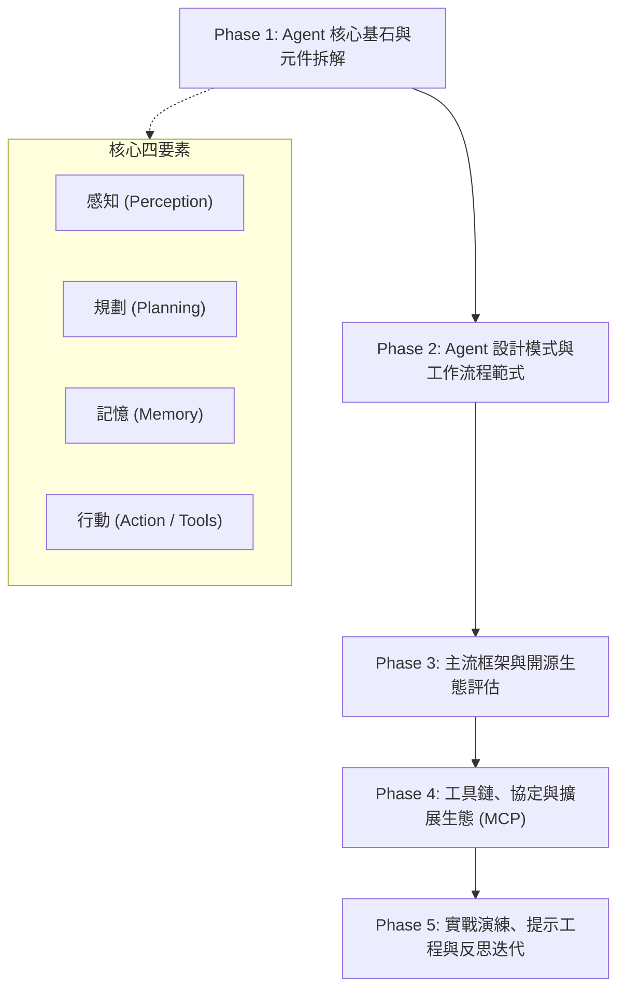

# agents.md - 專案工作藍圖 (Project Blueprint)

> **核心理念**：以 Agent 來學習 Agent —— 透過與 AI Agent 的深度對話、拆解分析與協作實驗，建立完整、現代且實用的 AI Agent 知識與實踐體系。

---

## 1. 藍圖架構概覽 (Roadmap Architecture)

---

## 2. 階段性研究與學習藍圖

### Phase 1: Agent 核心基石 (Foundations)
- [ ] **1.1 Agent 概念與自主性光譜**：從 Simple LLM Chain 到完全自主 Agent 的階梯。
- [ ] **1.2 規劃能力 (Planning)**：
  - 目標分解 (Sub-goal Decomposition)
  - 思考回饋 (Chain-of-Thought, Tree-of-Thought)
  - 自我反思與修訂 (Self-Reflection, Self-Correction)
- [ ] **1.3 記憶機制 (Memory)**：
  - 短期記憶 (In-context, Working Memory, Buffer)
  - 長期記憶 (Vector DB, RAG, 知識圖譜, 外部儲存)
- [ ] **1.4 工具使用與行動 (Tool Use & Action)**：
  - Function Calling 原理
  - API 調用與沙盒環境安全機制

### Phase 2: Agent 設計模式與架構範式 (Patterns & Architectures)
- [ ] **2.1 經典推論模式**：
  - ReAct (Reason + Act) 模式深度拆解
  - Plan-and-Solve 模式
  - Reflexion (評估與反饋循環)
- [ ] **2.2 多代理人協作 (Multi-Agent Collaboration)**：
  - 階層式架構 (Hierarchical / Supervisor-Worker)
  - 合作協商 (Peer-to-Peer, Collaboration)
  - 辯論與對抗模式 (Debate / Adversarial verification)

### Phase 3: 主流框架與開源生態評估 (Frameworks & Ecosystem)
- [ ] **3.1 狀態圖與流程控制**：LangGraph 原理與適用場景。
- [ ] **3.2 角色扮演與自主社群**：CrewAI, AutoGen 對比與實踐。
- [ ] **3.3 輕量與可擴展框架**：Google Antigravity 內建 Agent 機制與自定義 subagent。

### Phase 4: 工具鏈、協定與擴展生態 (Protocols & Tooling)
- [ ] **4.1 Model Context Protocol (MCP)**：
  - MCP 架構與通訊協定（Client / Server / Host）
  - 常見 MCP 伺服器分析（檔案系統、GitHub、資料庫、搜尋）
- [ ] **4.2 權限邊界與安全性**：Human-in-the-loop (HITL)、操作確認、沙盒防護。

### Phase 5: 實踐應用與總結 (PoC & Synthesis)
- [ ] **5.1 提示工程最佳實踐 (Prompt Engineering for Agents)**：System Prompt 構建、Few-shot 指導、動態上下文注入。
- [ ] **5.2 總結與個人化 Agent 知識庫**：整理結構化知識手冊與決策指南。

---

## 3. 當前進度看板 (Status Kanban)

| 狀態 | 項目 | 負責 / 協同 | 關聯文檔 |
| :--- | :--- | :--- | :--- |
| **已完成 (Done)** | 專案初始化與結構建立 | User & Agent | [README.md](file:///e:/用Agent來學習Agent/README.md), [ANTIGRAVITY.md](file:///e:/用Agent來學習Agent/ANTIGRAVITY.md) |
| **已完成 (Done)** | 工作藍圖制定 (`agents.md`) | User & Agent | [agents.md](file:///e:/用Agent來學習Agent/agents.md) |
| **進行中 (In Progress)** | 規劃 Phase 1 研究起點與章節筆記結構 | User & Agent | [notes/README.md](file:///e:/用Agent來學習Agent/notes/README.md) |
| **待辦 (Backlog)** | Phase 1.1: 探討 Agent 核心定義與自主性光譜 | 待開始 | `notes/01-foundations/` |

---

## 4. 決策日誌與踩坑筆記 (Log & Insights)

- **2026-10-09**：
  - 建立專案藍圖 `agents.md`，確認專案採取知識庫與研究筆記導向。
  - 確立以「開工／收工」工作流嚴謹管理進度與版本控制。
